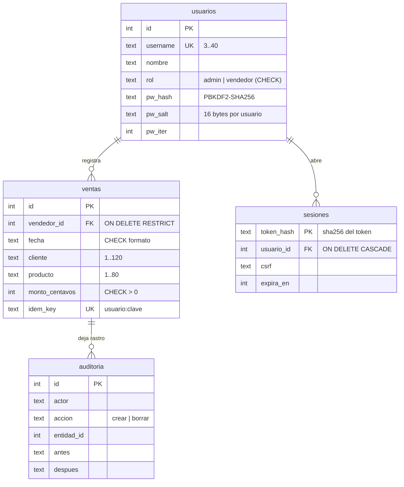

# Modelo de datos

Base relacional embebida (archivo local). Dinero en centavos enteros; fechas ISO `AAAA-MM-DD`.
Implementación: `app/db.py` (`MIGRATIONS`).

## Migraciones (`schema_migrations`)

| Versión | Nombre | Up | Down |
|---|---|---|---|
| 1 | esquema inicial | `usuarios`, `ventas`, `sesiones` con CHECK, UNIQUE y FK | drop en orden inverso |
| 2 | índices y auditoría | `ix_ventas_fecha`, `ix_ventas_vendedor_fecha`, `ix_sesiones_expira`, `auditoria` | drop de la tabla e índices |

- Cada paso es una transacción; `python3 app/cli.py migrate --to N [--dry-run]` sube o baja.
- Índices cubren los filtros del resumen (rango de fechas y vendedor + fecha).
- Seeds idempotentes: 4 usuarios demo y ~180 ventas de 12 meses (semilla fija), solo si faltan.
- Datos personales: solo nombres de vendedores y razones sociales de clientes; retención indefinida en la demo.
- Sin multi-tenant: una base por equipo.
