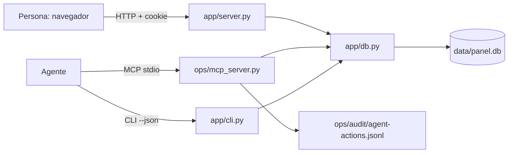

# Interfaz y arquitectura

## Arquitectura

Una sola capa de reglas (`app/db.py`) para web, MCP y CLI: el agente no puede saltarse validación ni roles.

## Pantallas (wireframe)

| Pantalla | Contenido | Estados |
|---|---|---|
| `/login` | usuario, contraseña, botón | error genérico, bloqueo 429 |
| `/dashboard` | barra superior (nombre, rol, tema, salir) · rangos rápidos + desde/hasta · 4 KPIs · barras por mes · barras por vendedor · formulario de venta · tabla (25 más recientes; admin puede borrar) | carga (contenido atenuado), vacío (mensaje + invitación a registrar), error (alerta + Reintentar), validación por campo |

## Gráficos

- Columnas por mes (una serie; sin leyenda: el título la nombra), barras horizontales por vendedor con valor en la punta.
- Marcas ≤ 24 px con extremo redondeado de 4 px y base recta; grilla de 1 px; ticks redondos.
- Tooltip al pasar el puntero y al enfocar con teclado; cada barra tiene `aria-label` con mes o vendedor, monto y cantidad.
- Texto de datos siempre con `textContent`; sin librerías ni HTML inyectado.

## Guía de estilo (LIGHT)

Tokens CSS en `app/static/app.css` (`--surface`, `--text`, `--text-2`, `--series-1`, `--grid`…) con valores propios para
claro y oscuro (sistema operativo o botón "Modo oscuro"); tipografía del sistema; foco visible de 2 px; contraste de texto ≥ 4.5:1.
