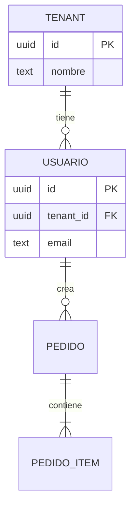

# Estándar de database

## Modelado

- ERD en Mermaid (`erDiagram`) como documentación viva del esquema, actualizado con cada migración
  que cambie relaciones o entidades.
- Normalización (3FN) por defecto; desnormalización solo cuando un patrón de lectura medido lo
  justifica, y documentada en el propio esquema (comentario o ADR del ADS).

## Migraciones y seeds

- Toda migración es versionada y reversible (`up`/`down` o equivalente); una migración sin camino de
  reversión documenta por qué no lo tiene.
- Seeds idempotentes: correrlos dos veces no duplica datos ni falla.

## Índices, integridad y rendimiento

- Clave foránea, `UNIQUE` y `CHECK` como primera línea de integridad, no solo validación en
  aplicación.
- Índice en toda columna usada en filtro, `JOIN` u orden de una consulta frecuente; el plan de
  ejecución de las consultas críticas se revisa antes de cerrar la unidad.

## RLS, permisos y auditoría

- Row-Level Security (o equivalente) activado en tablas multi-tenant o con datos sensibles;
  permisos por rol a nivel de base, no confiados solo a la capa de aplicación.
- Cambios sobre datos sensibles quedan en una tabla o mecanismo de auditoría: quién, qué, cuándo,
  valor anterior y nuevo.

## Backups y restauración

- Backup automatizado con frecuencia declarada y RPO/RTO objetivo; la restauración se prueba
  periódicamente, no solo se asume que el backup funciona.

## Multi-tenant

- Aislamiento por fila (`tenant_id` + RLS) como default; aislamiento por esquema o por base cuando
  el perfil o el volumen lo exige. La estrategia elegida queda documentada.

## Tipos generados

- Los tipos de la aplicación se generan desde el esquema (o el esquema desde los tipos, según el
  stack), nunca se mantienen a mano en paralelo: evita el drift entre base y código.

## Privacidad y retención

- Cada tabla o columna con datos personales queda clasificada; existe una política de retención y
  un mecanismo de purga o anonimización cuando el dato deja de necesitarse.

## Escalamiento

- Réplicas de lectura para separar carga de lectura de escritura cuando el perfil lo exige;
  particionado quando el volumen de una tabla lo justifica (medido, no anticipado sin evidencia).

## Tests

Ver `standards/testing.md` de esta carpeta: de migraciones (aplican y revierten limpio) y de datos
(integridad referencial, constraints, fixtures realistas).
